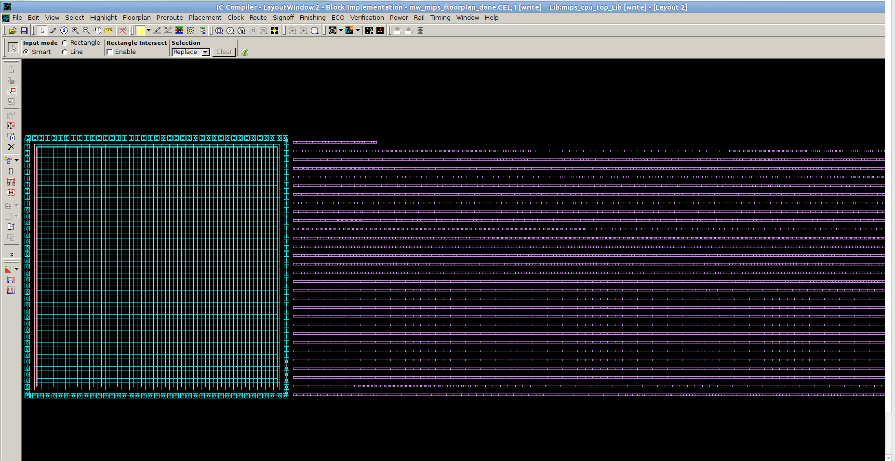
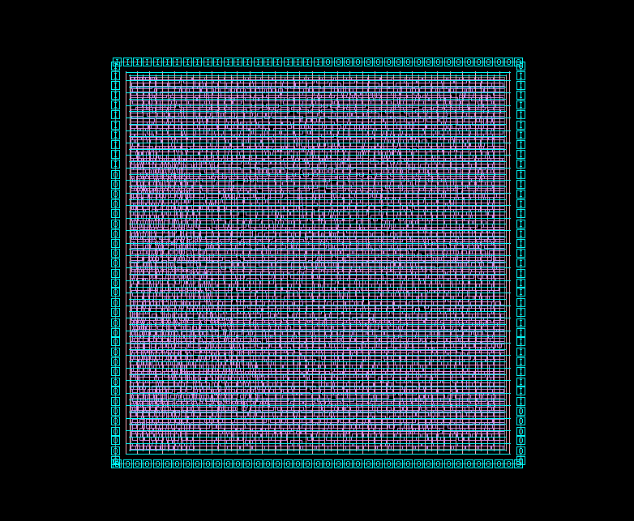
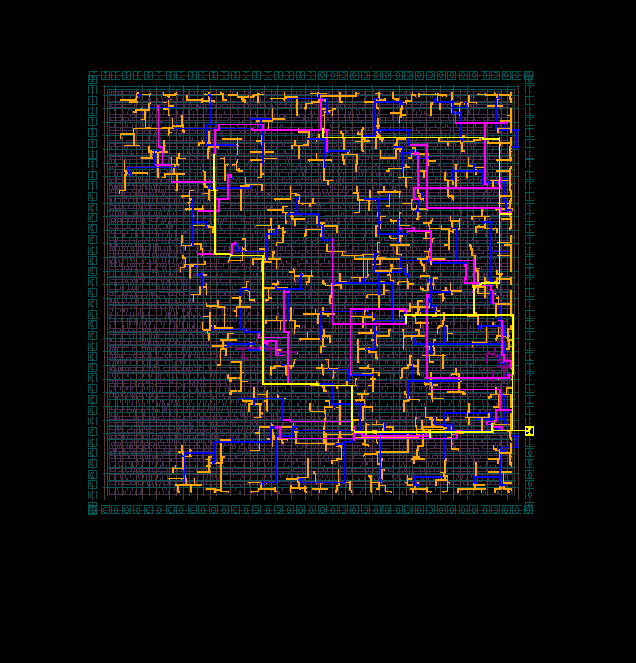
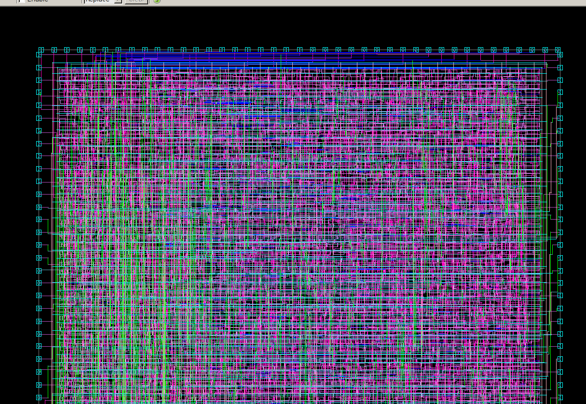
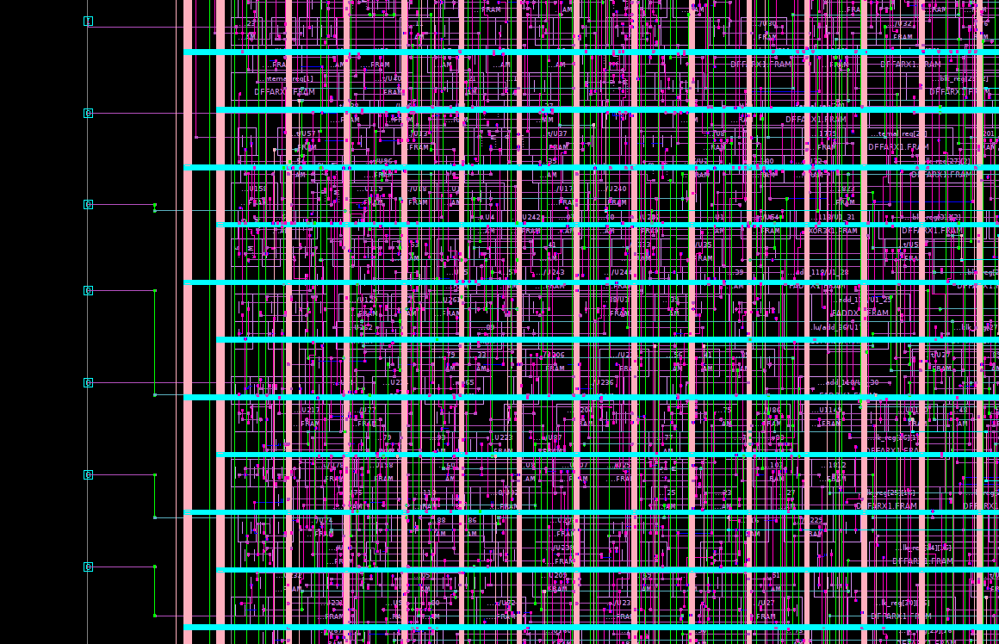
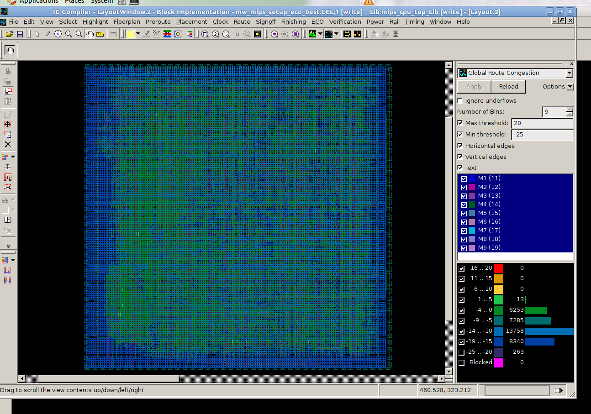

# MIPS CPU ASIC Physical Design Flow

This project implements a complete ASIC design flow for a MIPS CPU, from RTL design and functional simulation to logic synthesis, physical design, and static timing analysis.
This project focus on physical design.
The project uses the Synopsys ASIC toolchain and the SAED 90 nm standard-cell technology library.

---

## 1. Project Overview

The overall ASIC implementation flow is:

```text
RTL Design
    │
    ▼
RTL Simulation
   (VCS)
    │
    ▼
Logic Synthesis
(Design Compiler)
    │
    ├──────────────► Post-Synthesis Verification
    │                       │
    │                   Formality
    │                   PrimeTime
    │                       │
    ▼                       │
Physical Design             │
(IC Compiler)               │
    │                       │
    ├── Import              │
    ├── Floorplan           │
    ├── Placement           │
    ├── CTS                 │
    └── Routing             │
    │                       │
    ▼                       │
Post-Layout Netlist         │
    │                       │
    ├──────────────► Post-Layout Simulation
    │
    ├──────────────► Formal Verification
    │
    └──────────────► PrimeTime STA
```

The main objective of this project is to study and implement the complete RTL-to-layout ASIC flow and analyze timing, placement, clock distribution, congestion, and routing results.

---

## 2. Repository Structure

```text
.
├── dc/
│   ├── dc_script.tcl
│   └── dc_report/
│
├── fm/
│   ├── post_syn/
│   └── post_layout/
│
├── icc/
│   ├── import_script/
│   ├── floorplan_script/
│   ├── placement_script/
│   ├── cts_script/
│   ├── routing_script/
│   └── report/
│
├── image/
│
├── netlist/
│   ├── mips_cpu_top_NL.v
│   └── mips_cpu_top_post_layout.v
│
├── pt/
│   ├── post_syn/
│   └── post_layout/
│
├── report/
│   ├── pt/
│   └── pt_post_layout/
│
├── rtl/
│
├── sdc/
│
├── tb/
│
└── vcs/
    ├── pre_syn/
    ├── post_syn/
    └── post_layout/
```

---

## 3. Design

The top-level module is:

```text
mips_cpu_top
```

The RTL source code is located in:

```text
rtl/
```

Main RTL modules:

```text
rtl/
├── mips_cpu_top.v
├── mips_controller.v
├── mips_datapath.v
├── mips_alu.v
├── alu_ctrl.v
├── reg_file.v
└── shifter.v
```

The testbench is located at:

```text
tb/tb_mips.v
```

---

# 4. RTL Simulation

RTL functional simulation is performed using **Synopsys VCS**.

The pre-synthesis simulation scripts are located in:

```text
vcs/pre_syn/
```

```text
vcs/pre_syn/
├── run_pre_syn.sh
└── run_leda.sh
```

The purpose of this stage is to verify the functional correctness of the RTL design before synthesis.

```text
RTL
 │
 ├── mips_cpu_top.v
 ├── mips_datapath.v
 ├── mips_controller.v
 └── ...
 │
 ▼
Testbench
 │
 ▼
VCS
 │
 ▼
Functional Verification
```

Post-synthesis and post-layout simulation environments are also prepared in:

```text
vcs/post_syn/
vcs/post_layout/
```

---

# 5. Logic Synthesis

Logic synthesis is performed using **Synopsys Design Compiler**.

The synthesis script is:

```text
dc/dc_script.tcl
```

The synthesis flow converts RTL into a technology-mapped gate-level netlist.

```text
RTL
 │
 ▼
Read / Elaborate
 │
 ▼
Apply Timing Constraints
 │
 ▼
Technology Mapping
 │
 ▼
Timing / Area Optimization
 │
 ▼
Gate-Level Netlist
```

The synthesized netlist is:

```text
netlist/mips_cpu_top_NL.v
```

The timing constraints are stored in:

```text
sdc/mips_cpu_top_SDC.sdc
```

### Synthesis Reports
Reports are used to analyze:

- Cell area
- Cell utilization
- Technology mapping
- Resource usage
- Timing QoR
- Design consistency

---

# 6. Post-Synthesis Verification

Formal verification after synthesis is performed using **Synopsys Formality**.

The script is located at:

```text
fm/post_syn/fm_script.tcl
```

The goal is to verify the functional equivalence between:

```text
RTL Design
    │
    │ compare
    ▼
Synthesized Netlist
```

This ensures that synthesis optimization has not changed the intended functionality of the CPU.

---

# 7. Physical Design

Physical implementation is performed using **Synopsys IC Compiler (ICC)**.

The physical design flow consists of:

```text
Synthesized Netlist
        │
        ▼
      Import
        │
        ▼
    Floorplanning
        │
        ▼
     Placement
        │
        ▼
Clock Tree Synthesis
        │
        ▼
      Routing
        │
        ▼
 Post-Layout Design
```

The ICC scripts are organized as:

```text
icc/
├── import_script/
│   └── import.tcl
│
├── floorplan_script/
│   └── floorplan.tcl
│
├── placement_script/
│   └── placement.tcl
│
├── cts_script/
│   └── cts.tcl
│
└── routing_script/
    └── route.tcl
```

Reports generated by each stage are stored under:

```text
icc/report/
```

---

# 8. Design Import

The first ICC stage imports the synthesized netlist into a Milkyway design database.

Script:

```text
icc/import_script/import.tcl
```

Main inputs include:

```text
Gate-Level Netlist
        +
SDC Constraints
        +
Technology File
        +
Milkyway Reference Library
        +
TLU+ Files
```

The imported design is used as the starting checkpoint for physical implementation.

Typical Milkyway checkpoint:

```text
mw_mips_imported
```

Import reports are stored in:

```text
icc/report/import_report/
```

---

# 9. Floorplanning

Floorplanning defines the physical structure of the chip before standard-cell placement.

Script:

```text
icc/floorplan_script/floorplan.tcl
```

The floorplanning stage includes:

- Die and core definition
- Core utilization
- Standard-cell rows
- I/O pin placement
- Power and ground connections
- Power rings
- Power straps
- Standard-cell power rails

The power distribution hierarchy is:

```text
VDD / VSS Ports
      │
      ▼
   PG Rings
      │
      ▼
  PG Straps
      │
      ▼
 Cell Rails
      │
      ▼
VDD / VSS Cell Pins
```

Typical checkpoint:

```text
mw_mips_floorplan_done
```

## Floorplan Result



Floorplan reports are stored in:

```text
icc/report/floorplan_report/
```

---

# 10. Placement

The placement stage places all standard cells inside the core area while optimizing timing and routability.

Script:

```text
icc/placement_script/placement.tcl
```

The placement flow includes:

```text
Initial Placement
       │
       ▼
Timing Optimization
       │
       ▼
Congestion Optimization
       │
       ▼
Legalization
```

Important checks include:

```tcl
check_legality
report_timing
report_constraint
report_qor
report_congestion
```

Typical checkpoint:

```text
mw_mips_placed
```

## Placement Result



Placement reports are stored in:

```text
icc/report/placement_report/
```

including timing, congestion, utilization, legality, and QoR reports.

---

# 11. Clock Tree Synthesis

Clock Tree Synthesis (CTS) builds the physical clock distribution network.

Script:

```text
icc/cts_script/cts.tcl
```

CTS attempts to control:

```text
Clock Skew
Clock Latency
Clock Transition
Clock Fanout
```

Clock buffers and delay cells may be inserted by ICC to improve clock quality and timing.

Typical flow:

```text
Clock Source
     │
     ▼
 Clock Buffers
   /   |   \
  /    |    \
FF     FF    FF
```

Typical checkpoint:

```text
mw_mips_cts
```

## CTS Result



Post-CTS analysis includes both:

```text
Setup Timing
Hold Timing
Clock Tree Quality
```

CTS reports are stored in:

```text
icc/report/cts_report/
```

---

# 12. Routing

Routing creates the physical metal interconnections between all placed cells.

Script:

```text
icc/routing_script/route.tcl
```

The routing process consists conceptually of:

```text
Placement
    │
    ▼
Global Routing
    │
    ▼
Track Assignment
    │
    ▼
Detailed Routing
    │
    ▼
Routing Optimization
```

Main ICC routing commands include:

```tcl
route_opt
route_opt -incremental
```

Routing verification is performed using:

```tcl
verify_zrt_route
```

Placement legality is checked again after routing:

```tcl
check_legality
```

---

## Global Routing Congestion

Global routing congestion is analyzed before detailed routing.


The congestion report can be generated using:

```tcl
report_congestion -grc_based -by_layer -routing_stage global
```

---

## Routed Design

### Routing View 1



### Routing View 2



---

## Detailed Routing Congestion

After detailed routing, congestion can also be inspected visually.



Typical routed checkpoint:

```text
mw_mips_route
```

Routing reports are stored in:

```text
icc/report/route_report/
```

and include:

```text
route_before_congestion.rpt
route_before_setup.rpt
route_before_hold.rpt
route_routeability_check.rpt

route_mips_cpu_top_setup.rpt
route_mips_cpu_top_hold.rpt
route_mips_cpu_top_qor.rpt
route_mips_cpu_top_legality.rpt
route_mips_cpu_top_zrt_verify.rpt
route_mips_cpu_top_final_verify.rpt
```

---

# 13. Physical Design Checkpoints

Milkyway checkpoints are used to preserve each major implementation stage.

```text
mw_mips_imported
        │
        ▼
mw_mips_floorplan_done
        │
        ▼
mw_mips_placed
        │
        ▼
mw_mips_cts
        │
        ▼
mw_mips_route
```

Each implementation stage should create a new checkpoint before modifying the design.

This allows the design to be rolled back to a clean implementation stage if a later stage encounters problems.

---

# 14. Post-Layout Netlist

After physical implementation, the post-layout gate-level netlist is stored as:

```text
netlist/mips_cpu_top_post_layout.v
```

The post-layout timing constraints are located at:

```text
sdc/mips_cpu_top_post_layout.sdc
```

These files can be used for:

```text
Post-Layout Simulation
Formal Verification
Static Timing Analysis
Timing Signoff
```

---

# 15. Static Timing Analysis

Static Timing Analysis is performed using **Synopsys PrimeTime**.

The repository contains both post-synthesis and post-layout STA environments:

```text
pt/
├── post_syn/
│   └── pt_script.tcl
│
└── post_layout/
    └── pt_script.tcl
```

The main timing paths analyzed include:

```text
Input → Flip-Flop
Flip-Flop → Flip-Flop
Flip-Flop → Output
Input → Output
```

Important timing checks include:

```text
Setup Time
Hold Time
Maximum Transition
Maximum Capacitance
```

For a timing-clean design:

```text
Setup WNS >= 0
Setup TNS = 0

Hold WNS >= 0
Hold TNS = 0
```

---

# 16. PrimeTime Reports

Post-synthesis PrimeTime reports are stored in:

```text
report/pt/
```

including:

```text
setuptiming.rpt
holdtiming.rpt
floptoflop.rpt
floptoputputs.rpt
inputstoflops.rpt
inputstooutputs.rpt
tran_captiming.rpt
```

Post-layout PrimeTime reports are stored in:

```text
report/pt_post_layout/
```

---

# 17. Formal Verification

The repository provides two Formality stages:

```text
fm/
├── post_syn/
└── post_layout/
```

The verification strategy is:

```text
              RTL
               │
        ┌──────┴──────┐
        │             │
        ▼             ▼
 Synthesized      Post-Layout
   Netlist          Netlist
        │             │
        ▼             ▼
  Formality       Formality
```

The purpose is to ensure that synthesis and physical implementation do not alter the intended functionality of the RTL design.

---

# 18. Timing and Physical Verification

Important verification steps throughout the ICC flow include:

```tcl
check_timing
check_legality
check_physical_design
check_routeability

report_timing
report_constraint
report_qor
report_congestion

verify_zrt_route
```

These checks are used to identify:

- Setup violations
- Hold violations
- Maximum transition violations
- Maximum capacitance violations
- Illegal placement
- Cell overlap
- Cells outside the core
- Routing congestion
- Routing shorts or opens
- Physical design issues

---

# 19. Reports

The project stores reports separately for each implementation stage:

```text
icc/report/
├── import_report/
├── floorplan_report/
├── placement_report/
├── cts_report/
└── route_report/
```

This makes it easier to compare design quality throughout the physical design flow:

```text
Floorplan
   │
   ▼
Placement QoR
   │
   ▼
CTS QoR
   │
   ▼
Post-Route QoR
```

---

# 20. Tools

The project uses the following Synopsys tools:

| Tool | Purpose |
|---|---|
| **VCS** | RTL and gate-level simulation |
| **Design Compiler** | Logic synthesis |
| **Formality** | Formal equivalence checking |
| **IC Compiler** | Floorplan, placement, CTS, and routing |
| **PrimeTime** | Static timing analysis |

Technology library:

```text
SAED 90 nm
```

---

# 21. Project Goals

The main goals of this project are to gain practical experience with:

- RTL design and simulation
- Logic synthesis
- Timing constraints
- Formal equivalence checking
- Floorplanning
- Power planning
- Standard-cell placement
- Congestion analysis
- Clock Tree Synthesis
- Setup and hold timing closure
- Global and detailed routing
- Static Timing Analysis
- ASIC physical design methodology

The project demonstrates the complete relationship between logical design and physical implementation:

```text
RTL
 ↓
Netlist
 ↓
Timing Constraints
 ↓
Physical Placement
 ↓
Clock Distribution
 ↓
Metal Routing
 ↓
Post-Layout Timing
```

---

# 22. Current Project Flow

```text
mips_cpu_top.v
      │
      ▼
     VCS
      │
      ▼
Design Compiler
      │
      ├──── Formality
      │
      ├──── PrimeTime
      │
      ▼
mips_cpu_top_NL.v
      │
      ▼
 IC Compiler
      │
      ├── Import
      │
      ├── Floorplan
      │
      ├── Placement
      │
      ├── CTS
      │
      └── Routing
      │
      ▼
mips_cpu_top_post_layout.v
      │
      ├──── Post-Layout VCS
      │
      ├──── Formality
      │
      └──── PrimeTime
      │
      ▼
 Physical / Timing Verification
```
