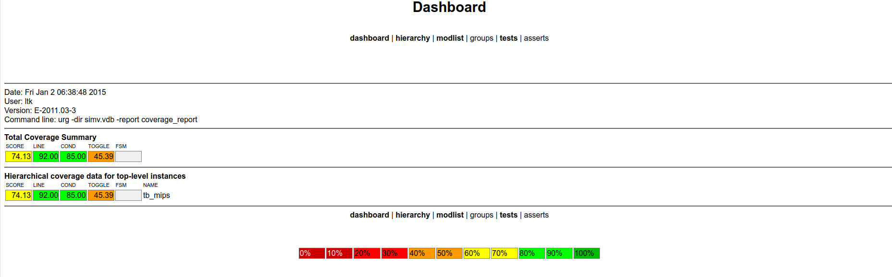

# MIPS CPU ASIC Physical Design Flow

Implementation and evaluation of a MIPS CPU using **Synopsys tools** and the **SAED 90 nm** standard-cell library. This project focuses on **physical design, post-layout timing analysis, manual ECO, and PPA evaluation**.

## Key Results

| Metric | Result |
|---|---:|
| Standard-cell area | **80,090.73 µm²** |
| Core utilization | **62.57%** |
| Standard-cell count | **4,730** |
| Target clock | **20 ns (50 MHz)** |
| Post-layout setup WNS (PrimeTime) | **−0.05 ns — violated** |
| Post-layout hold WNS (PrimeTime) | **+0.93 ns — met** |
| Estimated total power (PrimeTime PX) | **0.5107 mW** (vector-free) |

> **Timing/power note:** 50 MHz is the *target*, not a fully timing-closed operating frequency. Power is a vector-free estimate, not a workload-based measurement.

## 1. Implementation Flow

```text
RTL → VCS simulation → Design Compiler synthesis
                           │
                           ├── Post-synthesis verification (VCS / Formality)
                           ▼
                    IC Compiler (ICC)
            Import → Floorplan → Placement → CTS
                           → Routing → Manual ECO
                           │
                           ▼
                Post-layout netlist + SPEF
                           │
                           ▼
               PrimeTime STA / PrimeTime PX
```

| Stage | Tool | Status |
|---|---|---|
| RTL simulation and coverage | VCS | Completed |
| Logic synthesis | Design Compiler | Completed |
| Post-synthesis verification | VCS / Formality | Reported completed |
| Floorplan, placement, CTS, routing, ECO | IC Compiler | Completed |
| Post-layout setup/hold STA | PrimeTime | Completed |
| Post-layout power estimation | PrimeTime PX | Completed (vector-free) |
| Post-layout simulation / formal equivalence | VCS / Formality | Not started |

### Repository Layout

```text
rtl/                  # MIPS RTL
tb/                   # Testbench
vcs/                  # pre_syn/, post_syn/, post_layout/
dc/                   # Synthesis scripts
fm/                   # Formality: post_syn/, post_layout/
icc/                  # Import, floorplan, placement, CTS, routing scripts
pt/                   # PrimeTime analysis scripts
netlist/              # Synthesized and post-layout netlists
sdc/                  # Timing constraints
report/               # Timing, physical design, and PPA reports
image/                # Layout screenshots and coverage figures
```

## 2. RTL Verification and Synthesis

**VCS:** Functional simulation exercises the MIPS CPU using clock/reset, instruction memory, and data memory. The coverage dashboard reports **74.13% overall coverage**, including **92.00% line**, **85.00% condition**, and **45.39% toggle** coverage.



**Design Compiler:** RTL was mapped to the SAED90nm standard-cell library under SDC timing constraints. The synthesized netlist (`netlist/mips_cpu_top_NL.v`) is the input to ICC. Synthesis script: `dc/dc_script.tcl`.

**Formality:** Post-synthesis logical equivalence checking compares RTL (reference) with the synthesized netlist (implementation). Post-layout equivalence checking remains future work; detailed formal results are not included here.

## 3. Physical Design — Synopsys IC Compiler

The main physical design stages and checkpoints are:

| Stage | Main work | Checkpoint |
|---|---|---|
| Import | Load mapped netlist, SDC, physical/timing libraries | `mw_mips_imported` |
| Floorplanning | Core, I/O pins, VDD/VSS rings, straps and rails | `mw_mips_floorplan_done` |
| Placement | Place and optimize standard cells | `mw_mips_placed` |
| CTS | Build and route clock network; optimize hold | `mw_mips_cts` |
| Routing | Global routing, track assignment, detailed routing | `mw_mips_route_clean` |
| ECO | Cell sizing and incremental physical updates | `mw_mips_setup_eco_best` |

### 3.1. Floorplanning and Placement

Floorplanning defines the core and power distribution, followed by timing-driven placement and legality checks.


### 3.2. Clock Tree Synthesis

CTS inserts and balances clock buffers to control insertion delay, skew, transition and fanout. The final design reports **210 clock-tree buffers/inverters**.


### 3.3. Routing and Congestion

The successful routing flow used separate ZRoute stages:

```tcl
route_zrt_global
route_zrt_track
route_zrt_detail
verify_zrt_route
```

The routed design was checked for connectivity and physical violations.


<details>
<summary>Congestion maps</summary>

**Global routing congestion**


**Detailed routing congestion**


</details>

## 4. Post-Layout Static Timing Analysis

**PrimeTime D-2010.06-SP2** analyzed the routed netlist with SDC constraints, extracted SPEF parasitics and propagated clocks. Setup uses the maximum-delay (`saed90nm_max.db`) corner; hold uses the minimum-delay (`saed90nm_min.db`) corner.

| Constraint / timing metric | Value |
|---|---:|
| Clock period / target frequency | 20 ns / 50 MHz |
| Maximum input / output delay | 4 ns / 4 ns |
| Setup WNS / TNS (ICC, after ECO) | −0.03 ns / −0.03 ns |
| **Setup WNS (PrimeTime)** | **−0.05 ns — violated** |
| **Hold WNS (PrimeTime)** | **+0.93 ns — met** |

The setup-critical path passes through combinational datapath logic:

```text
Inst[22] → Register-file read MUX → 32-bit ALU subtractor → Addr[31]
```

The remaining **50 ps setup violation** means timing closure was not fully achieved at the 20 ns target period. The reported hold checks passed.

## 5. Manual Setup ECO

Five **cell-upsizing experiments** were evaluated after routing. ECO 1 was applied to the clean routed design; ECO 2–5 were each independently derived from ECO 1.

| Trial | Cell | Upsizing | ICC setup WNS |
|---|---|---|---:|
| Baseline | — | — | −0.06 ns |
| **ECO 1** | `sub_38/U188` | NAND2X0 → NAND2X2 | **−0.03 ns** |
| ECO 2 | `sub_38/U180` | NAND3X0 → NAND3X1 | −0.16 ns |
| ECO 3 | `u2_alu/U6` | AOI222X1 → AOI222X2 | −0.05 ns |
| ECO 4 | `sub_38/U169` | NAND3X0 → NAND3X1 | −0.17 ns |
| ECO 5 | `u1_reg_file/U1128` | MUX41X1 → MUX41X2 | −0.04 ns |

**ECO 1** gave the best ICC result: a **30 ps** improvement in setup WNS compared with the routed baseline. Other upsizing trials did not consistently improve timing. The selected implementation was saved as `mw_mips_setup_eco_best`.

## 6. Post-Layout PPA

| Category | Metric | Result |
|---|---|---:|
| Area | Combinational / noncombinational cell area | 46,028.39 / 34,062.34 µm² |
| Area | **Total standard-cell area** | **80,090.73 µm²** |
| Area | Core area | 127,991.81 µm² |
| Area | **Utilization** | **62.57%** |
| Area | Leaf cells / SRAM macros | 4,730 / 0 |
| Power | Cell internal | 0.1229 mW |
| Power | Net switching | 0.1290 mW |
| Power | **Dynamic (internal + switching)** | **0.2519 mW** |
| Power | Leakage | 0.2588 mW |
| Power | **Total estimated** | **0.5107 mW** |

Power was estimated in **PrimeTime PX averaged, vector-free mode** without VCD/SAIF activity annotation. It is a preliminary estimate for the configured library corner and default/propagated activity; it should **not** be interpreted as measured CPU power while executing a specific program.

## 7. Limitations and Next Steps

- **Setup:** The worst setup slack remains negative (−0.05 ns in PrimeTime).
- **Power:** Use workload-based VCD/SAIF activity for a more representative dynamic-power estimate.
- **Verification:** Complete post-layout simulation and formal equivalence checks.
- **Optimization:** Investigate the register-file read path and ALU subtractor to improve timing structurally.

This project demonstrates the practical **RTL-to-post-layout implementation workflow**, including physical-design debugging, clock-tree and routing analysis, post-layout STA, and manual ECO trade-offs.
